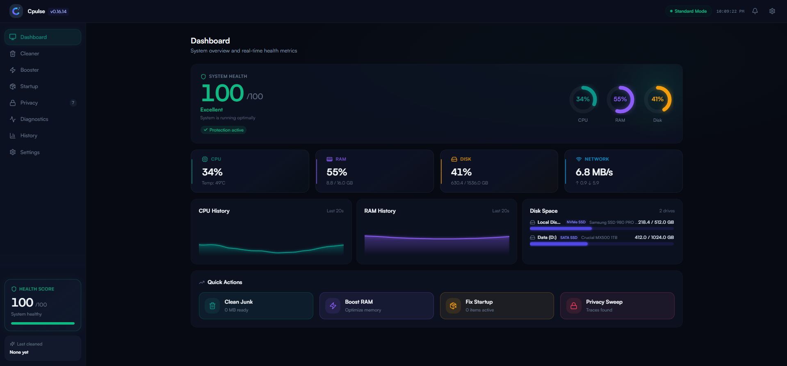
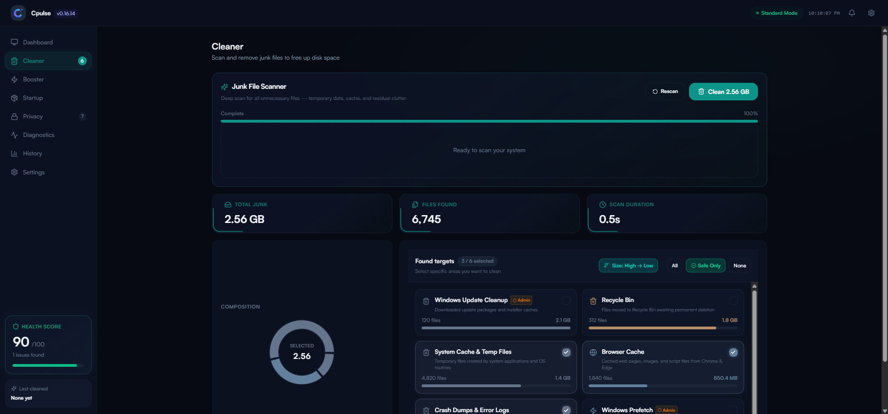
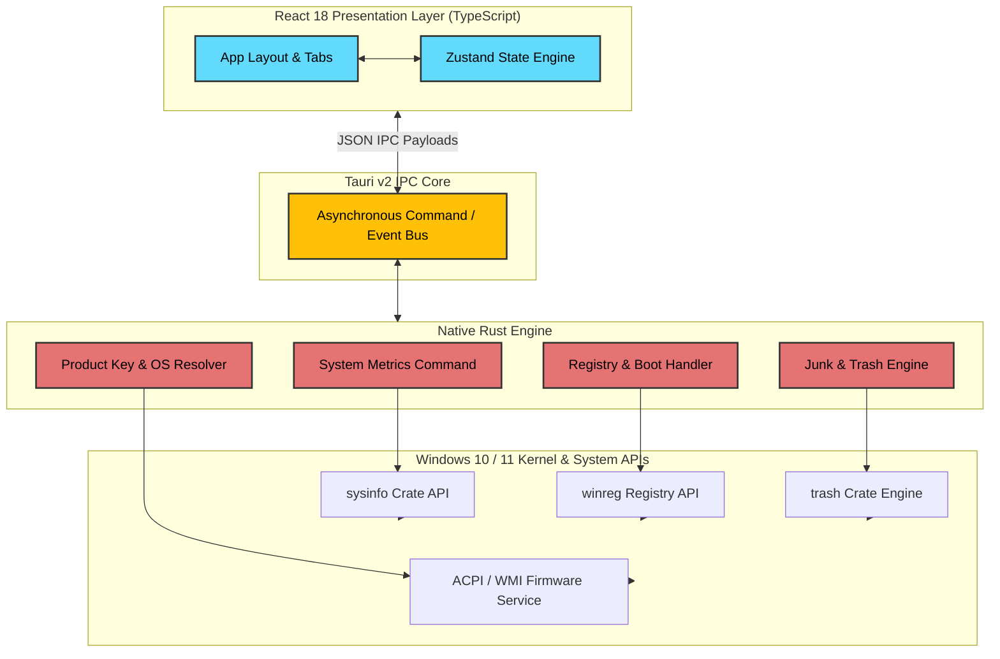

# ⚡ CPulse — Windows System Monitor & Cleaner

<p align="center">
  
</p>

<h1 align="center">CPulse</h1>

<p align="center">
  <b>Modern, fast, and lightweight open-source Windows system monitor, performance booster, and junk cleaner.</b><br />
  Built natively with <b>Tauri v2</b>, <b>Rust</b>, and <b>React 18 (TypeScript)</b>.
</p>

<p align="center">
  <a href="https://github.com/MuhammadAlif09/Cpulse/releases"><strong>Download Latest Release »</strong></a>
  &nbsp;•&nbsp;
  <a href="https://github.com/MuhammadAlif09/Cpulse/issues/new?template=bug_report.md">Report Bug</a>
  &nbsp;•&nbsp;
  <a href="https://github.com/MuhammadAlif09/Cpulse/issues/new?template=feature_request.md">Request Feature</a>
  &nbsp;•&nbsp;
  <a href="#-roadmap">Roadmap</a>
</p>

<p align="center">
  <a href="https://github.com/MuhammadAlif09/Cpulse/actions/workflows/ci.yml">
    
  </a>
  <a href="https://github.com/MuhammadAlif09/Cpulse/releases">
    
  </a>
  <a href="https://tauri.app/">
    
  </a>
  <a href="https://react.dev/">
    
  </a>
  <a href="https://www.rust-lang.org/">
    
  </a>
  <a href="https://www.typescriptlang.org/">
    
  </a>
  <a href="LICENSE">
    
  </a>
  <a href="https://github.com/MuhammadAlif09/Cpulse/pulls">
    
  </a>
</p>

> 🚧 **Active Development**: CPulse is under active development. Core features are stable and continuously tested, with new capabilities and optimizations released regularly.

---

## 📑 Table of Contents

- [Overview](#-overview)
- [Why CPulse?](#-why-cpulse)
- [Performance & Benchmarks](#-performance--benchmarks)
- [Security & Privacy](#-security--privacy)
- [Key Features](#-key-features)
- [Application Screenshots](#-application-screenshots)
- [System Architecture](#-system-architecture)
- [Capabilities Matrix](#-capabilities-matrix)
- [Made For](#-made-for)
- [Tech Stack](#-tech-stack)
- [Project Structure](#-project-structure)
- [Development Workflow](#-development-workflow)
- [Getting Started](#-getting-started)
  - [Prerequisites](#prerequisites)
  - [Installation \& Local Development](#installation--local-development)
  - [Production Build](#production-build)
- [Available Commands](#-available-commands)
- [Configuration](#-configuration)
- [Frequently Asked Questions (FAQ)](#-frequently-asked-questions-faq)
- [Roadmap](#-roadmap)
- [Future Vision](#-future-vision)
- [Contributing](#-contributing)
- [License \& Attributions](#-license--attributions)

---

## 📖 Overview

**CPulse** is a next-generation Windows desktop system monitor, performance booster, and junk cleaner engineered for users who demand deep diagnostic visibility without compromising system performance.

Traditional system utilities often rely on heavy browser runtimes or background telemetry agents that consume hundreds of megabytes of RAM. CPulse bridges native performance with modern UI design by leveraging a lightweight **Rust backend core** powered by **Tauri v2** alongside a responsive **React 18 + TypeScript** interface.

The result is instant startup times, sub-50 MB memory usage, completely offline operation, and direct interaction with low-level Windows APIs.

---

## 💡 Why CPulse?

| Benchmark / Criteria | CPulse ⚡ | Traditional Electron Utilities | Legacy Native Cleaners |
| :--- | :--- | :--- | :--- |
| **Backend Engine** | Native Rust (Tauri v2 IPC) | Embedded Node.js Runtime | C / C++ Legacy Binaries |
| **Idle Memory Usage** | **< 45 MB RAM** | 200 MB - 450 MB RAM | 30 MB - 80 MB RAM |
| **Startup Speed** | **Instant (< 0.8s)** | 2.5s - 5.0s | 1.0s - 2.0s |
| **Installer Size** | **~15 MB** | 80 MB - 150 MB | 20 MB - 50 MB |
| **Telemetry & Privacy** | **100% Offline / Zero Telemetry** | Often Bundled | Mixed / Adware bundled |
| **User Interface** | Modern React + Motion UI | Modern Web UI | Outdated Win32 UI |
| **Source Model** | **100% Open Source (MIT)** | Closed / Proprietary | Proprietary / Freemium |

---

## ⚡ Performance & Benchmarks

| Metric | Measured Value | Notes / Measurement Environment |
| :--- | :--- | :--- |
| **Idle RAM Footprint** | `~38.5 MB` | Measured on Windows 11 Pro 23H2 (x64) via Windows Task Manager |
| **Cold Startup Time** | `< 0.8s` | Launch to interactive state |
| **Installer Size** | `~14.8 MB` | Standalone `.msi` / `.exe` setup package |
| **CPU Usage (Background)** | `< 0.2%` | Sub-second hardware polling tick interval |
| **Network Overhead** | `0 KB/s` | Zero background network requests; 100% offline local fonts & assets |

---

## 🛡️ Security & Privacy

- 🔒 **Rust Memory Safety**: Core operations (file manipulation, registry access, hardware metrics retrieval) are compiled natively in memory-safe Rust.
- 🌐 **100% Offline-First**: Zero external telemetry, tracking scripts, or mandatory internet connections.
- 🛡️ **Hardened Content Security Policy (CSP)**: Strict webview security preventing arbitrary remote script execution.
- 📦 **Zero External Font/Asset CDNs**: All fonts (Satoshi & Inter) and SVG assets are bundled locally within the binary.
- ⚡ **Granular Windows Privileges**: Runs safely in un-elevated mode for daily monitoring, prompting UAC elevation only when executing system-level operations (SSD TRIM, Windows Update cache cleaning).

---

## ✨ Key Features

| Module | Features & Functions |
| :--- | :--- |
| **🖥️ System Dashboard** | Live telemetry monitoring of CPU load, RAM usage, storage IOPS, and network bandwidth. Includes an automated System Health Score engine and UAC status indicator. |
| **🗑️ Smart Junk Cleaner** | Asynchronous scanning of `%TEMP%`, Windows Update cache, Chrome/Edge browser caches, system event logs, and crash dumps with category filters (*Safe Only*, *Sort by Size*, *Select All*). |
| **🚀 Performance Booster** | One-click RAM memory trimming, DNS cache flushing, TCP/IP stack optimization, SSD TRIM execution, and high-performance power plan switching. |
| **⚙️ Startup Manager** | Registry-level boot management (`HKCU\Software\Microsoft\Windows\CurrentVersion\Run`) to inspect, enable, or disable startup applications. |
| **🔒 Privacy Care** | Sweeping engine for activity traces, clipboard history, RunMRU records, web browser caches, and obsolete Wi-Fi profiles. |
| **🔑 Windows Key Viewer** | Direct extraction of OEM BIOS/Firmware Product Keys (`OA3xOriginalProductKey`) and Windows Registry product key credentials with mask/reveal toggles, copy, and `.txt` export. |
| **🎨 Modern UI & i18n** | Full Dark/Light theme switching, motion animations, and complete bilingual localization in English and Indonesian (`en` / `id`). |

---

## 🖼️ Application Screenshots

<p align="center">
  
  
</p>
<p align="center">
  <i>System Telemetry Dashboard (Left) and Smart Junk Cleaner Interface (Right)</i>
</p>

<details>
<summary><b>View Additional Module Screenshots</b></summary>
<br />

> **Note**: Screenshots for Booster, Startup Manager, Privacy Care, and Settings modules are updated automatically with every major release in [`assets/screenshots/`](assets/screenshots/).

</details>

---

## 📐 System Architecture

CPulse utilizes the Tauri v2 IPC architecture to separate the React presentation layer from system-level execution in Rust.



---

## 📊 Capabilities Matrix

| Feature | Execution Handler | Target System Location / Windows API | Privilege Level |
| :--- | :--- | :--- | :--- |
| **System Telemetry** | `sysinfo` Rust Crate | Kernel Performance Counters & CPU registers | Standard User |
| **Temporary Cleaning** | Asynchronous Tokio File I/O | `%TEMP%`, `%SYSTEMROOT%\Temp`, Browser Caches | Standard / Admin |
| **Windows Update Clean** | Dism / System Cleanup API | `%SYSTEMROOT%\SoftwareDistribution\Download` | Administrator |
| **RAM Memory Trimming** | Win32 Memory Management API | EmptyWorkingSet / System Working Sets | Standard User |
| **Network DNS Flush** | Windows DnsFlushResolverCache | Dnsapi.dll / WinSock | Standard User |
| **Startup Item Manager** | `winreg` Rust Crate | `HKCU\Software\Microsoft\Windows\CurrentVersion\Run` | Standard User |
| **Windows License Key** | ACPI Table & Registry Query | Firmware `OA3xOriginalProductKey` & `DigitalProductId` | Standard User |

---

## 🎯 Made For

- 💻 **Power Users & Developers**: Who want deep diagnostic insights and instant junk removal without resource-heavy utility bloat.
- 🎮 **Gamers**: Who need one-click RAM trimming, power scheme switching, and network stack optimization before launching high-demand games.
- 🔐 **Privacy Enthusiasts**: Who require zero-telemetry software that runs 100% offline with zero external network connections.
- 🛠️ **IT Administrators**: Who need a portable, fast utility to inspect system metrics, manage boot programs, and retrieve OEM Windows Product Keys.

---

## 🛠️ Tech Stack

| Layer | Technology | Version | Purpose |
| :--- | :--- | :--- | :--- |
| **Desktop Shell** | [Tauri v2](https://tauri.app/) | `2.x` | Native window management, IPC IPC bridge, security capabilities |
| **Backend Language** | [Rust](https://www.rust-lang.org/) | `1.77+` | Safe, high-performance system execution engine |
| **Frontend Framework** | [React](https://react.dev/) | `18.x` | Component-driven presentation layer |
| **Language** | [TypeScript](https://www.typescriptlang.org/) | `5.x` | End-to-end type safety |
| **Styling** | [Tailwind CSS](https://tailwindcss.com/) | `4.x` | Modern utility-first styling architecture |
| **UI Primitives** | [Radix UI](https://www.radix-ui.com/) | Latest | Accessible UI components (shadcn/ui design tokens) |
| **State Management** | [Zustand](https://zustand-demo.pmnd.rs/) | `5.x` | Reactive global state store |
| **Animations** | [Motion](https://motion.dev/) | `12.x` | Declarative UI micro-animations |
| **Data Visualization** | [Recharts](https://recharts.org/) | `2.x` | Precision hardware telemetry charts |
| **Localization** | [i18next](https://www.i18next.com/) | `24.x` | Multi-language translation support (`en`, `id`) |

---

## 📁 Project Structure

```text
Cpulse/
├── .github/
│   └── workflows/        # GitHub Actions CI/CD (CI verification & release build pipelines)
├── assets/               # Branding graphics, icons, and application screenshots
├── permissions/          # Tauri v2 security capabilities and scope definitions
├── src/                  # React 18 Frontend Source Code
│   ├── app/
│   │   ├── components/   # UI elements, telemetry gauges, metric cards, dialogs
│   │   ├── features/     # Application tab modules (Dashboard, Cleaner, Booster, Startup, Privacy, Settings)
│   │   ├── hooks/        # Reactive hooks for hardware monitoring and scanning
│   │   ├── i18n/         # i18next translation catalogs (en/id)
│   │   └── store/        # Zustand global state stores
│   ├── assets/           # Bundled offline fonts (Satoshi, Inter) and local vectors
│   ├── styles/           # Tailwind CSS directives and custom theme configuration
│   └── main.tsx          # React application entry point
├── src-tauri/            # Native Rust Backend Core
│   ├── capabilities/     # Desktop security capability files
│   ├── src/              # Rust command modules (cleaner, system info, product key query)
│   ├── Cargo.toml        # Rust package manifest & dependencies
│   └── tauri.conf.json   # Tauri v2 application configuration
├── package.json          # Frontend dependencies & npm script definitions
└── vite.config.ts        # Vite bundle compiler setup
```

---

## 🔄 Development Workflow

```text
  [ Feature Branch ]  ──►  [ Local Verification (Lint + Vitest) ]  ──►  [ Pull Request ]
                                                                             │
  [ GitHub Release ]  ◄──  [ Release Workflow (msi/exe) ]  ◄──  [ CI Workflow (main) ]
```

- **`main` Branch**: Production-ready code. All commits are verified via GitHub Actions CI.
- **Feature Branches (`feature/*` or `fix/*`)**: Created for individual updates or bug fixes prior to PR review.

---

## 🚀 Getting Started

### Prerequisites

Ensure the following tools are installed on your Windows development environment:

1. **Rust Toolchain & C++ Build Tools**:
   ```powershell
   # Install Rust via Rustup
   winget install Rustlang.Rustup

   # Install Visual Studio 2022 C++ Build Tools (Required by Tauri)
   winget install Microsoft.VisualStudio.2022.BuildTools --override "--add Microsoft.VisualStudio.Workload.VCTools --includeRecommended"
   ```

2. **Node.js** (v20+ or v22 recommended):
   ```powershell
   winget install OpenJS.NodeJS
   ```

3. **pnpm** (Package Manager v10+):
   ```powershell
   npm install -g pnpm
   ```

### Installation & Local Development

```bash
# 1. Clone the repository
git clone https://github.com/MuhammadAlif09/Cpulse.git
cd Cpulse

# 2. Install dependencies (generates/verifies pnpm-lock.yaml)
pnpm install

# 3. Boot application in local development mode (Hot Module Reload)
pnpm tauri dev
```

### Production Build

To compile a native Windows installer (`.msi` or standalone `.exe` setup package):

```bash
pnpm tauri build
```

Compiled binaries will be generated inside `src-tauri/target/release/bundle/`.

---

## 📜 Available Commands

| Command | Action |
| :--- | :--- |
| `pnpm tauri dev` | Launches the complete desktop application in development mode with HMR. |
| `pnpm dev` | Runs the Vite frontend web server independently. |
| `pnpm build` | Compiles the React frontend into static assets. |
| `pnpm tauri build` | Compiles the production Rust backend & packages native Windows installer. |
| `pnpm test` | Runs the Vitest test suite. |
| `pnpm test:coverage` | Generates unit test coverage reports. |
| `pnpm lint` | Runs ESLint analysis with strict zero-warning policy. |
| `pnpm lint:fix` | Automatically resolves fixable linting warnings. |
| `pnpm format` | Formats source files using Prettier. |

---

## ⚙️ Configuration

- **`src-tauri/tauri.conf.json`**: Controls application window parameters, bundle details, Tauri plugin configurations, and security policies.
- **`src-tauri/capabilities/desktop.json`**: Defines granular API permissions granted to the React webview layer.

> **TODO:** Add documented environment flags if custom build profile triggers are added.

---

## ❓ Frequently Asked Questions (FAQ)

<details>
<summary><b>Why build CPulse with Tauri instead of Electron?</b></summary>
Electron bundles a full Chromium browser and Node.js runtime with every app, causing heavy RAM consumption (>200 MB idle) and large installer sizes (>100 MB). Tauri uses the native Windows WebView2 runtime paired with a Rust core, resulting in a ~15 MB installer, sub-50 MB RAM usage, and instant startup times.
</details>

<details>
<summary><b>Does CPulse run completely offline?</b></summary>
Yes! CPulse is 100% offline-first. All fonts, icons, styling rules, and system routines are contained within the local binary. It sends zero telemetry or analytical data to external servers.
</details>

<details>
<summary><b>Does CPulse require Administrator privileges?</b></summary>
Standard monitoring, temporary junk file cleaning, and startup item inspection operate without administrator rights. Deep system cleaning (such as Windows Update cache purging) or SSD TRIM requires administrator privileges. Elevation status is displayed via a UAC status badge on the dashboard.
</details>

<details>
<summary><b>Which Windows versions are supported?</b></summary>
CPulse fully supports Windows 10 and Windows 11 (64-bit editions).
</details>

<details>
<summary><b>Are macOS or Linux builds planned?</b></summary>
While CPulse uses cross-platform frameworks (Tauri + React), many system APIs (such as Windows Registry, Windows Product Key lookup, and Windows Update cache cleanup) are Windows-specific. Cross-platform support is scheduled for future exploration under our roadmap.
</details>

---

## 📌 Roadmap

- [x] Real-time CPU, RAM, Disk, and Network telemetry monitoring
- [x] Asynchronous junk file scanner and cleaner engine
- [x] Performance booster (RAM trim, DNS flush, TCP/IP optimization, SSD TRIM)
- [x] Windows Registry startup manager
- [x] Privacy care trace cleaning
- [x] Windows Product Key viewer with OEM ACPI BIOS & Registry lookup
- [x] Hardened Content Security Policy & 100% offline local font assets
- [x] Dual English & Indonesian localization (`en` / `id`)
- [ ] 🟡 Automated background auto-updater integration via Tauri Updater
- [ ] 🟡 Additional browser cleaning support (Firefox, Brave, Opera)
- [ ] ⬜ One-Click Full System Maintenance workflow
- [ ] ⬜ Winget package repository distribution (`winget install CPulse`)
- [ ] ⬜ Exportable HTML / PDF System Diagnostic Health Reports

---

## 🔮 Future Vision

- 🔌 **Plugin System**: Allowing community developers to create custom cleaning rules for specialized developer tools (Node.js `node_modules`, Docker cache, Rust `target/` folders).
- 📊 **Historical Diagnostics Engine**: Archiving weekly and monthly hardware performance statistics for diagnostic troubleshooting.
- 🕒 **Scheduled Automatic Cleaning**: Autonomous background maintenance during system idle states.

---

## 🤝 Contributing

Contributions are welcome and appreciated!

1. **Fork** the repository on GitHub.
2. **Create** a feature branch:
   ```bash
   git checkout -b feature/amazing-feature
   ```
3. **Validate** code quality prior to committing:
   ```bash
   pnpm lint
   pnpm test
   ```
4. **Commit** your changes following standard conventional commit conventions:
   ```bash
   git commit -m "feat: add amazing feature"
   ```
5. **Push** to your branch:
   ```bash
   git push origin feature/amazing-feature
   ```
6. **Open** a Pull Request.

---

## 📜 License & Attributions

- Distributed under the **MIT License**. See [`LICENSE`](LICENSE) for complete licensing terms.
- Third-party dependencies and open-source attributions are documented in [`ATTRIBUTIONS.md`](ATTRIBUTIONS.md).

---

<p align="center">
  Crafted with ❤️ by <a href="https://github.com/MuhammadAlif09">Muhammad Alif</a>
</p>

---

### Improvements Made
- **Header & Navigation**: Re-architected top banner with title, tagline, badge matrix (CI build status, Tauri v2, React 18, Rust, TypeScript, License, PRs Welcome), and quick navigation links.
- **Status Callout**: Added an active development status callout blockquote.
- **"Why CPulse?" Comparison**: Added a detailed comparison table showcasing CPulse against traditional Electron utilities and legacy Win32 cleaners across memory footprint, binary size, startup speed, and privacy model.
- **Performance & Security Sections**: Created explicit sections detailing real-world benchmark metrics (idle RAM, cold startup time, binary size) and security features (Rust memory safety, zero-telemetry, offline local assets, CSP).
- **Tabular Feature Cards**: Converted bulleted lists into a clean feature table for instant scannability.
- **Enhanced System Architecture**: Expanded the Mermaid architectural diagram detailing Frontend, Tauri Bridge, Backend Engine, and Windows Kernel APIs.
- **Target Audience & Workflow**: Introduced dedicated "Made For" and "Development Workflow" sections.
- **Comprehensive FAQ & Detailed Roadmap**: Added questions on offline support, admin privileges, OS support, and cross-platform plans, along with an interactive status roadmap.
- **Future Vision**: Added long-term open-source project goals (plugins, scheduled maintenance, diagnostic exports).

### Suggestions
- **Animated GIF Demo**: Capture a short screen recording (`docs/demo.gif` or `assets/demo.gif`) showcasing real-time scanning and dashboard telemetry micro-animations to embed directly in the header section.
- **Winget Package Setup**: Add a `winget` manifest submission to enable direct `winget install CPulse` terminal commands.
