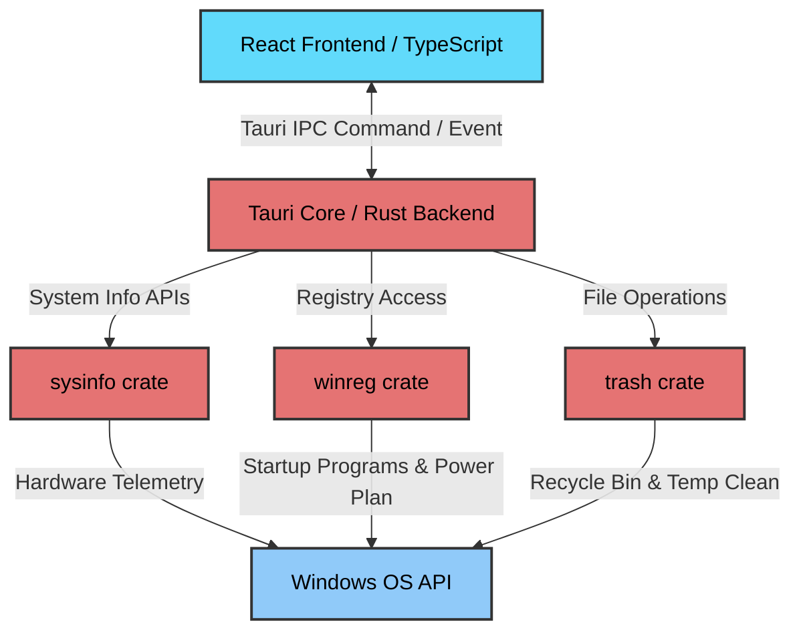

# ⚡ CPulse

<p align="center">
  
</p>

<h3 align="center">CPulse</h3>

<p align="center">
  Aplikasi desktop Windows modern, cepat, dan ringan untuk membersihkan sampah sistem, mengoptimasi performa, dan menjaga privasi PC Anda. Dibangun menggunakan <b>Tauri v2</b> dan <b>React (TypeScript)</b>.
</p>

<p align="center">
  <a href="https://github.com/MuhammadAlif09/Cpulse/releases">
    
  </a>
  <a href="https://tauri.app/">
    
  </a>
  <a href="https://react.dev/">
    
  </a>
  <a href="https://www.typescriptlang.org/">
    
  </a>
  <a href="https://www.rust-lang.org/">
    
  </a>
  <a href="LICENSE">
    
  </a>
</p>

---

## 🖼️ Pratinjau Aplikasi

<p align="center">
  
  
</p>

---

## 📐 Arsitektur Sistem

CPulse memanfaatkan arsitektur Tauri v2 yang memisahkan antara frontend UI dan backend sistem secara aman melalui IPC (Inter-Process Communication).



---

## ✨ Fitur Utama

- **🖥️ Dasbor Real-time**: Telemetri CPU, RAM, Disk, dan Jaringan secara langsung. Deteksi status UAC dan Skor Kesehatan Sistem secara real-time.
- **🗑️ Pembersih Sampah**: Pencarian mendalam (Deep Scan) untuk file sementara (Temp), cache peramban (Chrome & Edge), sisa Windows Update, dan file crash dump.
- **🚀 Pengoptimal Performa**: Manajemen prioritas CPU, optimasi jaringan (konfigurasi TCP/IP & flush DNS), optimasi disk (TRIM SSD), serta mode daya performa tinggi/Gaming Mode.
- **⚙️ Pengoptimal Startup**: Deteksi dan kelola program startup langsung melalui Windows Registry untuk mempercepat proses boot.
- **🔒 Pembersih Privasi**: Membersihkan riwayat sistem, clipboard, daftar RunMRU, password Wi-Fi lama, dan riwayat aktivitas Windows.

---

## 📊 Matriks Kapabilitas

| Kategori | Fitur & Fungsi | Metode Sistem | Target Lokasi |
| :--- | :--- | :--- | :--- |
| **Junk Cleaner** | Pembersihan File Sampah | Pengapusan File/Direktori | `%TEMP%`, `%SYSTEMROOT%\Temp`, Browser Cache, Windows Update |
| **Booster** | Optimasi Jaringan & RAM | Flush DNS, TCP Tweaks | Windows DNS Cache, WinSock API |
| **Disk Care** | TRIM & Recycle Bin | Defrag API, Trash Shell | System Drives (SSD/HDD), `$RECYCLE.BIN` |
| **Startup** | Manajemen Boot Startup | Registry RW | `HKCU\Software\Microsoft\Windows\CurrentVersion\Run` |
| **Privacy** | Pembersih Privasi | Registry / Command Execution | RunMRU, Clipboard Service, WiFi Profiles |

---

## 🛠️ Papan Teknologi (Tech Stack)

* **Frontend**: React 18, TypeScript, Tailwind CSS, Radix UI (shadcn/ui)
* **Backend**: Tauri v2, Rust (menggunakan library `sysinfo`, `winreg`, `trash`, dll.)
* **State Management**: Zustand
* **Grafik**: Recharts

---

## 🚀 Memulai (Getting Started)

### Prasyarat (Prerequisites)

Untuk membangun proyek ini secara lokal, Anda membutuhkan perkakas berikut terinstal di Windows Anda:

1. **Rust & C++ Build Tools** (Dibutuhkan oleh Tauri):
   ```powershell
   # Install via winget
   winget install Rustlang.Rustup
   winget install Microsoft.VisualStudio.2022.BuildTools --override "--add Microsoft.VisualStudio.Workload.VCTools --includeRecommended"
   ```
2. **Node.js** (v22 direkomendasikan):
   ```powershell
   winget install OpenJS.NodeJS
   ```
3. **pnpm** (Manajer paket):
   ```powershell
   npm install -g pnpm
   ```

### Pemasangan & Pengembangan (Dev Mode)

```bash
# 1. Kloning repositori
git clone https://github.com/MuhammadAlif09/Cpulse.git
cd Cpulse

# 2. Instal dependensi
pnpm install

# 3. Jalankan dalam mode pengembangan
pnpm tauri dev
```

### Membangun Versi Rilis (Build Production)

```bash
pnpm tauri build
```
Hasil kompilasi file executable installer (`.msi` atau `.exe`) akan disimpan di direktori `src-tauri/target/release/bundle/`.

---

## 📌 Peta Jalan (Roadmap)

- [x] Antarmuka Gelap/Terang (Dark/Light mode)
- [x] CSP yang diperketat & Font lokal untuk performa optimal
- [ ] Pembaru Otomatis (Auto-updater)
- [ ] Dukungan peramban lain (Firefox, Brave)
- [ ] Pengoptimalan Sekali Klik (One-click Full Optimization)
- [ ] Versi Portabel + Paket Winget
- [ ] Ekspor laporan kesehatan sistem

---

## 🤝 Kontribusi

Kontribusi Anda sangat dihargai! Silakan ikuti langkah berikut:

1. **Fork** proyek ini.
2. Buat branch fitur baru (`git checkout -b feature/FiturBaru`).
3. Commit perubahan Anda (`git commit -m "feat: Menambahkan FiturBaru"`).
4. Push ke branch tersebut (`git push origin feature/FiturBaru`).
5. Ajukan **Pull Request** ke branch `dev`.

---

## 📄 Lisensi

Proyek ini dilisensikan di bawah **MIT License**. Lihat berkas [LICENSE](LICENSE) untuk detail lebih lanjut.

---
Dibuat dengan ❤️ oleh [Muhammad Alif](https://github.com/MuhammadAlif09)
